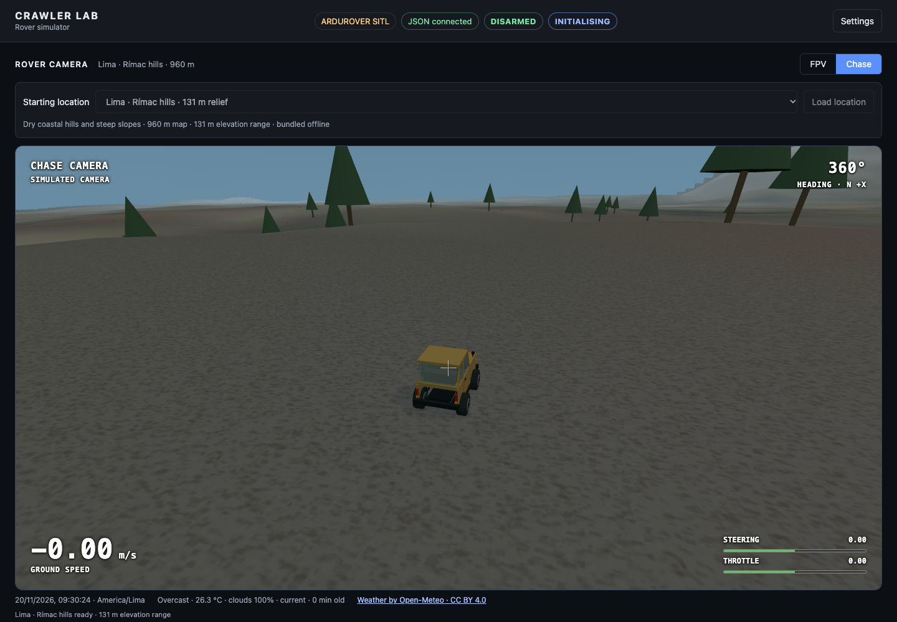

# Bundled location presets

Run `npm.cmd run sim -- --choose-location` in Windows, or double-click
`start-location-picker.cmd`. On macOS/Linux use `npm run sim -- --choose-location`.
Open `http://127.0.0.1:8090`, select a **Starting location**, and click **Load
location**. The launcher waits for that choice before starting SITL with the
selected terrain's latitude, longitude and elevation. Then click **Start physics**
and drive through Mission Planner as usual.

All five terrain patches and satellite colours are committed in `assets/terrain/`.
The picker does not need a download or a populated runtime cache. Weather still
uses its normal online lookup and offline fallback; the correct IANA timezone
is bundled with every preset.

| Preset | Centre | Elevation range across map | Offline asset |
| --- | --- | --- | --- |
| Kyiv · Feofaniya | 50.3375, 30.475 | about 56 m | `feofaniya.json` |
| Lviv · northern hills | 49.88, 24.055 | about 72 m | `lviv.json` |
| Lima · Rímac hills | -12.026, -77.028 | about 131 m | `lima.json` |
| Cusco · Andes | -13.485, -71.98 | about 185 m | `cusco.json` |
| Andes · mountain ravine | -13.49, -72.01 | about 206 m | `andes.json` |

These are measured max-minus-min mesh elevations, rounded to metres, within
each 960 × 960 m patch. They indicate the variety of slopes; they are not promises
that the small crawler can climb every slope. All maps have a small level spawn
pad. The mountain presets have much steeper terrain than Kyiv/Lviv.

Choose the location before SITL starts. The dropdown locks after loading so an
active autopilot cannot be moved to a different region. To change presets, stop
the launcher and launch the picker again. If loading an asset fails, **Retry
terrain** retries without restarting the backend. `--standalone --choose-location`
also works for keyboard testing without SITL.

The default `npm run sim` still loads Feofaniya automatically. The separate
`--mission-planner` mode still takes its start from Mission Planner's Simulation
map; it automatically reuses a bundled patch when the selected coordinates match
one of these exact origins. `--choose-location` cannot be combined with
`--mission-planner`, `--flat` or `--playground`.

## Data provenance

Every asset retains exact GEM-15 source URLs, Sentinel-2 scene ID and acquisition
date, source resolutions, EGM96 home elevation, and licence attribution. These
four additional patches were downloaded and validated on 2026-11-20 using the
existing importer. Their metadata is embedded in the JSON under `sources`.
No credentials or API keys are used.

Ground shape is Google GEM-15 bare-earth DTM with 15 m source spacing, resampled
to a 7.5 m output grid of 129 × 129 vertices. Colours come from historical
Copernicus Sentinel-2 imagery. Buildings, streets and individual obstacles are
not reconstructed; trees and rocks are generated. See [terrain data limits and
attribution](terrain.md).

Candidate areas with missing source data were excluded. The preset catalogue
contains only complete patches tested with the importer; other map-selected
locations can still have source coverage gaps. Successful arbitrary-location
downloads remain cached separately in `.run/terrain-cache/`.

`npm test` checks every bundled file's grid, coordinates, colours, provenance and
measured elevation range, and proves loading presets never calls the downloader.
`npm run test:locations` uses Chrome and native SITL to select Lima through the
dropdown and verifies its actual SITL home, timezone, collisions and narrow
layout. It reserves HTTP 8103, UDP 9010/14568 and TCP 5794/5796.
