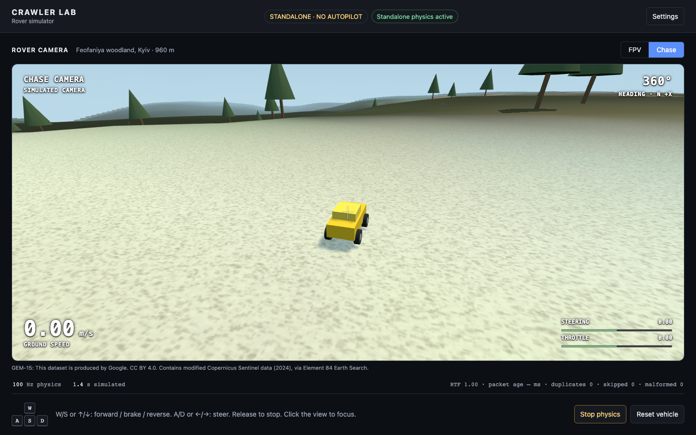

# Real terrain

`npm run sim` now loads a bundled 960 × 960 m patch of Feofaniya woodland near
Kyiv, centred on **50.3375 N, 30.475 E**. Windows uses `npm.cmd run sim` as usual.
Run `npm ci` after updating because the importer adds GeoTIFF/projection packages.
No account, API key, Python installation or network access is needed to drive.
The source patch is about 272 KiB of local JSON.

Five [bundled location presets](locations.md) are available with
`npm run sim -- --choose-location`: Kyiv, Lviv, Lima, Cusco and an Andes ravine.
Their complete elevation/colour assets are committed and load offline.



## What is measured and what is generated

- **Ground shape:** Google GEM-15 bare-earth DTM, native 15 m grid. Elevations are
  in metres with the EGM96 vertical datum. The bundled patch spans about 56 m
  vertically. A 7.5 m output grid interpolates those measurements; it does not
  add measured resolution.
- **Ground colour:** one Copernicus Sentinel-2 L2A true-colour scene from
  2024-08-17, native 10 m pixels, via Element 84 Earth Search. RGB is sampled onto
  terrain vertices. This gives broad land-cover colours, not sharp close-up
  aerial photographs or a photogrammetric city model.
- **Generated details:** repeating ground grain, trees and small rocks. These
  are not surveyed objects. Tree trunks and rocks have colliders; tree crowns
  are visual scenery. Boundary fences keep the rover on the imported patch.
- **Starting area:** a small level pad around the origin, blended into the
  measured terrain over 22.5 m radius. This intentional modification provides
  a stable starting point. It is not a measured clearing.

Three.js and Rapier use the same vertex positions, triangle indices and diagonal
orientation. Wheels contact the imported slopes; the landscape is not just a
background image. The local axes stay +X north, +Y up, +Z east. Coordinates are
converted through a local azimuthal-equidistant projection, so UTM grid convergence
does not rotate the map away from true north.

The launcher reads the terrain's geographic origin and passes it to SITL as
`--home lat,lon,alt,0`. Ground at the origin is local height zero; its original
EGM96 altitude (184.16 m for this patch) is kept as SITL home altitude. Changing
maps changes the simulated GPS region: replace old mission waypoints accordingly.
Saved EEPROM parameters remain intact; no wipe is needed to switch landscapes.

This remains a generic ray-wheel crawler model. Small ruts, kerbs, rocks and tyre
contact detail cannot be recovered from a 15 m DEM. Bare-earth estimates under
dense forest can also be inaccurate. The terrain is useful for landscape shape,
slopes and navigation practice rather than surveying or real-route validation.

## Select a landscape

`config/default.json` contains:

```json
"terrain": "feofaniya"
```

Set `terrain` to `null` for the original obstacle playground. Old backend configs
without `terrain` also retain that playground. A custom terrain JSON path resolves
relative to the backend config file, for example:

```json
"terrain": "../assets/terrain/my-map.json"
```

Restart the entire simulator after changing the map. Command-line alternatives:

```powershell
# Original 100 m obstacle playground:
npm.cmd run sim -- --playground
# Original empty flat world:
npm.cmd run sim -- --flat
# Real terrain with standalone keyboard driving:
npm.cmd run sim -- --standalone
```

`--flat` and `--playground` override the selected terrain and restore the old
Kyiv-city home coordinates. The separate shell/PowerShell SITL scripts still
use that original home: pair them with a backend started with `--playground` or
`--flat`. Use `npm run sim` for automatic terrain/home alignment.

## Import another area

The importer runs in the same npm package and needs network access only while
building the asset:

```powershell
npm.cmd run terrain:import -- --lat 50.3375 --lon 30.475 --name "My landscape" --out assets/terrain/my-map.json
```

It reads small windows from public cloud-optimised GeoTIFFs rather than downloading
whole regional rasters. It records the exact source asset URLs, scene ID,
acquisition date, resolutions and licences in the generated JSON. It writes
output only after the complete patch passes validation.

Options:

- `--size 129`: odd sample count per side, 3–257.
- `--spacing 7.5`: output sample spacing in metres, 1–30. Total width is
  `(size - 1) × spacing` and is limited to 3000 m.
- `--imagery-item URL`: pin a Sentinel-2 Earth Search STAC item with a `visual`
  RGB asset. Otherwise it chooses a low-cloud scene from a bounded summer 2024
  query; inspect the result because tile-wide cloud percentage does not guarantee
  a clear local patch.
- `--no-imagery`: import elevations with procedural ground colour only.

GEM-15 has coverage exclusions, masked water and other missing pixels. For small
elevation gaps, the importer estimates missing cells using inverse-distance
weighting of original valid neighbours within two source cells (30 m for GEM-15).
At most 1% of the fetched elevation window may be missing; every repaired cell
must have original valid data within that radius. Measured cells remain unchanged,
and the output records the repair count, method and limits in
`sources.elevation.gapFill`. Larger elevation gaps, missing colour samples and
patches crossing a raster tile boundary are rejected. Choose a smaller patch or
move the centre in those cases. Only UTM rasters are supported. The image is one scene,
so seasons, clouds and image boundaries may affect its appearance. The default
output is the bundled Feofaniya file; pass `--out` to keep that example unchanged.

To reproduce the bundled source imagery explicitly, use the recorded item:

```text
https://earth-search.aws.element84.com/v1/collections/sentinel-2-l2a/items/S2A_35UQR_20240817_0_L2A
```

## Sources and attribution

**Elevation:** “This dataset is produced by Google.” GEM-15 is distributed under
[CC BY 4.0](https://creativecommons.org/licenses/by/4.0/). The bundled elevations
are a cropped, interpolated, vertically offset and spawn-pad-modified derivative.
[Dataset and limitations](https://developers.google.com/earth-engine/datasets/catalog/projects_climate-and-sustainability_assets_gem-15_v1),
[source STAC item](https://storage.googleapis.com/climate-and-sustainability/gem-15/stac/gem-15/p50_p30/w30s50/w30s50.json).

**Colour:** contains modified Copernicus Sentinel data (2024). RGB has been sampled
and interpolated from the original scene.
[Sentinel-2 COG archive](https://registry.opendata.aws/sentinel-2-l2a-cogs/),
[Copernicus Sentinel data terms](https://sentinels.copernicus.eu/documents/247904/690755/Sentinel_Data_Legal_Notice),
[source scene](https://earth-search.aws.element84.com/v1/collections/sentinel-2-l2a/items/S2A_35UQR_20240817_0_L2A).

Attribution appears below the HUD and is embedded into the MJPEG camera frames.
Preserve source metadata and attribution when redistributing the terrain asset.

## Verification

```sh
npm test
npm run test:terrain
npm run test:launcher
```

The terrain browser smoke reserves HTTP 8096 and checks exact rendered mesh
positions/indices, colour attributes, attribution, wheel contacts, drive/reset and
narrow layout. It writes `docs/terrain.png`. Launcher smoke verifies selected
terrain/home, actual SITL startup, camera output and port cleanup on isolated
ports. Existing browser smoke deliberately retains the original playground as a
regression check.
